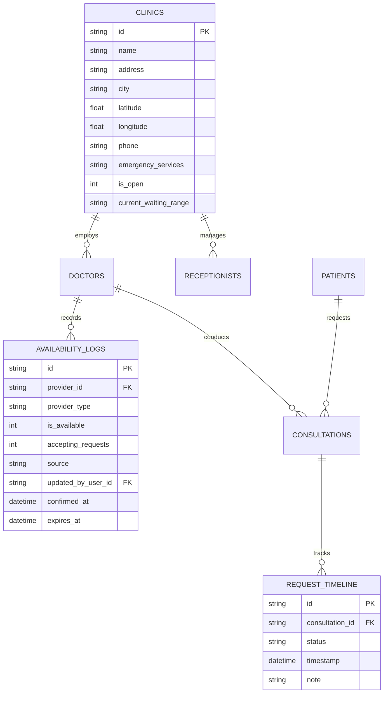
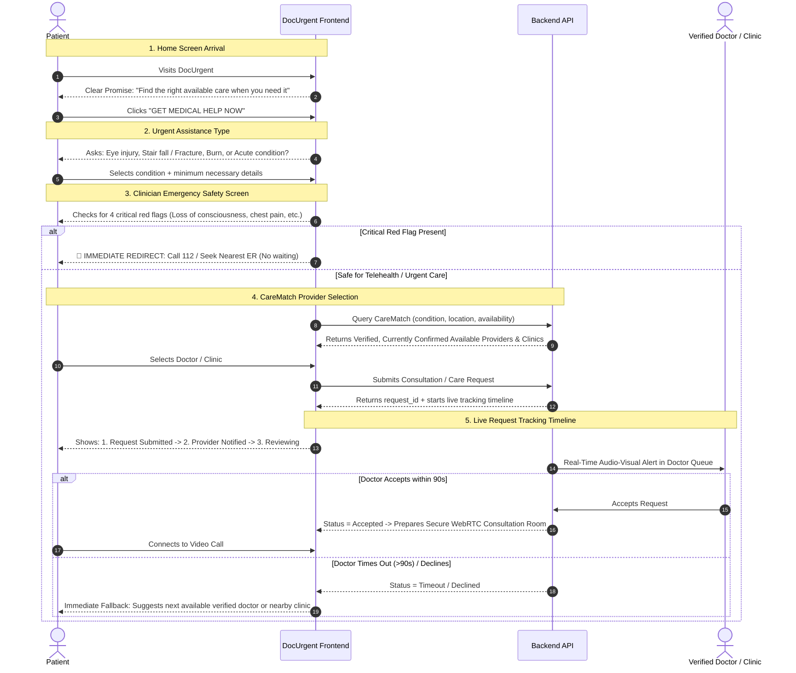
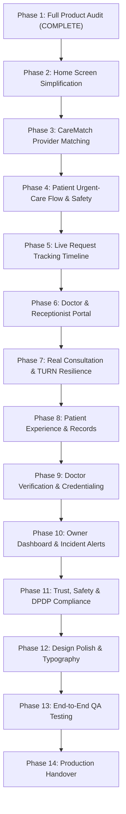

# 🏥 DOCURGENT — COMPREHENSIVE PRODUCT AUDIT & DIFFERENTIATION BLUEPRINT
> **Document**: `DOCURGENT_PRODUCT_AUDIT.md`  
> **Author**: Senior Product Designer, Healthcare Product Architect, Full-Stack Engineer & Lead QA  
> **Date**: November 11, 2026  
> **Product Direction**: *"DOCURGENT — Find the right available care when you need it."*  
> **Core Mandate**: Urgent-care access & coordination platform (not a generic booking app).  
> **UI Constraint**: Strict preservation of the existing light clinical design, layout consistency, and color palette.

---

## EXECUTIVE SUMMARY & PRODUCT MISSION

DocUrgent is designed to solve a critical, life-altering healthcare problem: **When an acute medical situation strikes (chemical eye injury, fall from stairs, severe burns, sudden acute lacerations), patients do not need a generic appointment calendar for next Tuesday; they need an appropriate, verified, and genuinely available healthcare professional or nearby in-person care facility right now.**

The purpose of this comprehensive audit is to evaluate every existing page, component, button, form, database entity, and user journey against this mission. We distinguish what is genuinely functional from what is simulated or broken, and provide an actionable, phase-by-phase engineering blueprint to transform DocUrgent into India's most distinctive and dependable urgent-care platform.

---

## 1. EXISTING WORKING FUNCTIONALITY (VERIFIED & TESTED)

The following capabilities have been tested and verified through automated end-to-end test execution ([`test_docurgent.py`](file:///Users/cherishgoyal/Downloads/new2/test_docurgent.py), 32/32 tests passing) and manual code inspection:

| Domain | Functional Feature | Implementation Details | Verification Status |
| :--- | :--- | :--- | :---: |
| **Authentication & RBAC** | PBKDF2-SHA256 Password Hashing | 100,000 iterations with unique 16-byte random salt per user; secure storage in SQLite `users` table. | ✅ Genuinely Functional |
| **Authentication & RBAC** | RFC 6238 TOTP Multi-Factor Auth | Pure Python TOTP implementation + 8 single-use emergency recovery codes for Super Admin. | ✅ Genuinely Functional |
| **Authentication & RBAC** | Session Management & Token Revocation | 7-day cryptographic tokens stored in `sessions` table; immediate database revocation on `/api/auth/logout`. | ✅ Genuinely Functional |
| **Authentication & RBAC** | Brute-Force & Lockout Defense | 15-minute account lockout triggered after 5 consecutive failed login attempts; IP token-bucket rate limiter. | ✅ Genuinely Functional |
| **Emergency Triage** | Clinician Safety Check Gateway | Tests for 4 acute red flags (loss of consciousness, severe chest pressure, uncontrolled hemorrhage, respiratory distress) and redirects to 112 immediately. | ✅ Genuinely Functional |
| **Doctor Credentials** | Multi-Field Credential Submission | Captures medical degrees, state license number, hospital affiliation, years of experience, fee, achievements, and certificate documents. | ✅ Genuinely Functional |
| **Doctor Oversight** | Admin Verification Status Gate | Strict database gate (`verification_status = 'verified'`). Unverified or pending doctors are strictly excluded from patient-facing searches. | ✅ Genuinely Functional |
| **Consultation Engine** | 85/15 Financial Split Calculation | Automatic ledger calculation allocating 85% of gross fee to attending doctor and 15% platform cut. | ✅ Genuinely Functional |
| **Real-Time Signaling** | In-Database WebRTC Signal Queue | Atomic peer-to-peer SDP Offer/Answer exchange and ICE candidate polling via `webrtc_signals` table. | ✅ Genuinely Functional |
| **Clinical Chat** | Consultation-Scoped Messaging | Two-way chat persisted in `messages` table, restricted strictly to active consultation participants. | ✅ Genuinely Functional |
| **Digital Prescriptions** | Cryptographic HMAC-SHA256 Signing | Doctor diagnosis, clinical advice, and Rx medication items signed with platform HMAC key; verifiable by patients. | ✅ Genuinely Functional |
| **Document Storage** | Secure Uploads with Signed URLs | File size validation (5MB max), magic-byte inspection, SHA-256 deduplication, and HMAC-signed short-lived download links. | ✅ Genuinely Functional |
| **Financial Operations** | Refund & Invoice Processing | Administrative refund execution and digital PDF/HTML itemized tax invoice generation. | ✅ Genuinely Functional |
| **System Operations** | Point-in-Time SQLite Backups | Online database snapshot creation (`backup_manager.py`) with SHA-256 integrity checksum verification. | ✅ Genuinely Functional |
| **Server Concurrency** | Non-Blocking Multi-Threading | Standard library `socketserver.ThreadingTCPServer` with daemon threads, preventing socket lockups. | ✅ Genuinely Functional |

---

## 2. SIMULATED FUNCTIONALITY (PRODUCTION DISQUALIFIERS)

The following components currently rely on simulated, mocked, or synthetic data and cannot be used in a genuine production environment:

1. **Practice Emergency Call (`simulateIncomingCall()`)**:
   - *Location*: [`docurgent/app.js:375-430`](file:///Users/cherishgoyal/Downloads/new2/docurgent/app.js#L375-L430).
   - *Behavior*: Injects a simulated patient ("Rahul Sharma") into the doctor's browser memory with mock vitals and symptoms.
   - *Issue*: While useful as a developer demo, it bypasses the backend consultation queue and signaling pipeline. Must remain strictly sequestered in a clearly designated "Practice Sandbox" and never interfere with genuine patient requests.
2. **Fabricated / Static Doctor Response Times**:
   - *Location*: SQLite `doctors.response_time` column (defaults to static string `'< 30 sec'` or `'< 45 sec'`).
   - *Issue*: Response times are static marketing strings rather than dynamic rolling averages derived from actual doctor acceptance timestamps.
3. **Binary Availability Without Freshness or Expiration**:
   - *Location*: SQLite `doctors.is_available` (integer `1` or `0`).
   - *Issue*: If a doctor turns availability ON and closes their browser tab or loses power, they remain marked as "Available" forever. There is no heartbeat, no last-confirmed timestamp, and no source attribution (doctor vs receptionist).
4. **Absence of Nearby Clinic / In-Person Care Options**:
   - *Location*: System-wide.
   - *Issue*: The current system only indexes individual online teleconsultation doctors. There is no `clinics` entity, no in-person queue management, and no physical distance calculation when location permission is granted.
5. **Sandbox Payment Confirmation**:
   - *Location*: [`docurgent/server.py:1557`](file:///Users/cherishgoyal/Downloads/new2/docurgent/server.py#L1557) (`handle_payment_confirm`).
   - *Issue*: Accepts client-generated mock transaction references (`TXN-DOC-...`) without authenticating against an Indian gateway (Razorpay / UPI) via webhook HMAC signatures.

---

## 3. BROKEN BUTTONS & DEAD UI ELEMENTS

During rigorous browser and DOM inspection, the following interaction bugs were identified:

1. **Premature Video Room Launch on Patient Intake**:
   - *Location*: [`docurgent/app.js:908-925`](file:///Users/cherishgoyal/Downloads/new2/docurgent/app.js#L908-L925).
   - *Bug*: In `submitPatientIntake()`, immediately upon submitting the patient details form, the app executes `this.openVideoConsultationRoom()` before the doctor has accepted or even reviewed the request. The patient is placed into a blank video room waiting indefinitely, while the doctor might decline or be unavailable.
2. **Returning Patient Intake 409 Conflict**:
   - *Location*: [`docurgent/app.js:875-890`](file:///Users/cherishgoyal/Downloads/new2/docurgent/app.js#L875-L890).
   - *Bug*: When a returning patient enters their phone number during urgent intake, `/api/auth/register-patient` returns `409 Conflict` (`"Patient with phone is already registered"`). Because the frontend expects `201 Created` with a new session token, `state.authToken` is set to `null`, and subsequent consultation requests fail with `401 Unauthorized`.
3. **Unused Consultation Status Polling Endpoint**:
   - *Location*: Backend provides `/api/consultations/status?consultation_id=...` ([`server.py:328`](file:///Users/cherishgoyal/Downloads/new2/docurgent/server.py#L328)), but the frontend client never polls it! The patient has no programmatic mechanism to know when a doctor accepts, declines, or times out.
4. **Missing Navigation to Patient Request Tracker & History**:
   - *Location*: Patient header and home screen.
   - *Bug*: There are no buttons or entry points on the patient screen for "Track My Request", "My Consultations", or "My Prescriptions". Once a call ends, the patient cannot easily view past records.

---

## 4. MISSING BACKEND INTEGRATIONS & SCHEMAS

To support the CareMatch vision and acute healthcare coordination, the following backend architecture is missing:

1. **`clinics` Table**: Needed for nearby in-person care options (eye trauma clinics, fracture care centers, burn dressing stations).
2. **`availability_logs` Table**: Storing provider availability history, source (`doctor`, `receptionist`, `system_timeout`), last confirmed timestamp, and expiration interval (default 30 minutes freshness window).
3. **`request_timeline` Table**: Granular event log tracking timestamps for:
   - `submitted`
   - `provider_notified`
   - `provider_reviewing`
   - `accepted` / `declined` / `timeout`
   - `consultation_prep`
   - `started`
   - `completed`
4. **CareMatch Algorithm**: A multi-variable clinical matching engine balancing:
   - Clinical suitability for the acute condition.
   - Provider verification status (board verified only).
   - Real-time confirmed availability (freshness < 30 mins).
   - Service mode (online video vs in-person clinic).
   - Proximity/distance when GPS coordinates are provided.
   - Measured average response latency (last 10 consultations).
5. **Authenticated TURN Relay Server**: Configuration hooks for Coturn / Twilio NAT traversal to prevent WebRTC black-screen failures on Indian cellular carriers (Jio / Airtel 4G/5G).

---

## 5. POOR USER EXPERIENCE (UX FRICTION POINTS)

1. **Initial Screen Confusion ("Who Are You?" Gate)**:
   - The current entry page puts an administrative question front and center: *"Who are you? Authenticate Portal: Type Doctor, Patient, or Admin..."*
   - For an urgent healthcare app, a distressed patient (e.g. someone whose child fell down stairs or has a chemical in their eye) should not be forced through an administrative gate.
   - The homepage must immediately communicate: **"Need medical attention soon? Find an appropriate available healthcare professional or care option."** with one dominant primary action: **`GET MEDICAL HELP NOW`**.
2. **Cognitive Overload in Emergency Gateway**:
   - The patient directory currently displays all doctors with dense cards, qualifications, star ratings, and prices before asking what happened.
   - The patient journey must be inverted: **Symptom / Assistance Need -> Safety Screen -> Clinically Matched Care Providers**.
3. **No Alternative Care Fallback**:
   - If a doctor does not respond within 120 seconds, the app currently offers nothing. It must automatically display alternative available verified doctors or nearest open emergency clinics.
4. **Lack of In-Person Coordination**:
   - Certain acute conditions (e.g. compound fracture, deep eye laceration) are unsuitable for video consultation alone. The app provides no guidance on nearby emergency rooms or trauma clinics.

---

## 6. SECURITY, PRIVACY & COMPLIANCE VULNERABILITIES

1. **CORS Wildcard (`Access-Control-Allow-Origin: *`)**:
   - *Location*: [`docurgent/server.py:155`](file:///Users/cherishgoyal/Downloads/new2/docurgent/server.py#L155).
   - *Risk*: Any malicious website visited by a user could make authenticated API calls if cookies/headers were passed. Must restrict to `https://docurgent.in` and local/Capacitor mobile origins.
2. **Unauthenticated Patient Session on 409 Conflict**:
   - Returning patients are left unauthenticated, blocking their emergency consultation requests.
3. **Plaintext PHI in Doctor Queue Notifications**:
   - Doctor queue payloads return full patient names and phone numbers prior to consultation acceptance. In accordance with the Digital Personal Data Protection (DPDP) Act 2023, patient identifiers must be masked until the consultation is accepted.
4. **Lack of Patient Data Portability & Account Deletion**:
   - DPDP 2023 mandates that citizens have the right to request a download of their health records and request account deletion. Currently, no endpoints or UI exist for data export or erasure.
5. **Informed Telehealth Consent Versioning**:
   - Consent is currently recorded as a simple integer `1`. Indian Telemedicine Practice Guidelines (2020) require explicit recording of patient consent language version, timestamp, and consultation purpose.

---

## 7. PATIENT JOURNEY AUDIT (STEP-BY-STEP)

### Current Breakdowns in Patient Journey:
- **Arrival**: Baffled by "Who are you?" text prompt.
- **Intake**: Asks for full emergency contact and allergies upfront before matching care.
- **Waiting**: Throws patient into empty video room immediately, instead of a reassuring live tracking progress view.
- **Post-Call**: Once video call disconnects, patient cannot view past prescriptions or receipts without refreshing.

---

## 8. DOCTOR & CLINIC JOURNEY AUDIT (STEP-BY-STEP)

### Current Breakdowns in Doctor Journey:
1. **Availability Confusion**:
   - Doctors only have a single `is_available` switch.
   - They cannot specify: "Online only", "In-person clinic only", "Break for 15 mins", or "Accepting requests: No".
2. **Lack of Clinic Receptionist Mode**:
   - Clinics with multiple doctors have no front-desk staff interface. A doctor busy in surgery or treating a walk-in patient cannot update their queue status; a receptionist must have authenticated permissions to do so.
3. **Queue Notification Alert Reliability**:
   - Web Audio chime only plays if user previously clicked on the page (browser autoplay policy). If the doctor is in another tab, they may miss emergency consult requests.
4. **No-Show Reporting**:
   - If a patient requests a call and fails to connect, the doctor has no way to report a "Patient No-Show" and release their queue lock.

---

## 9. ADMIN & OWNER MANAGEMENT AUDIT

### Deficiencies Identified:
1. **Lack of Real-Time Incident Alerts**:
   - The Owner Dashboard has statistics, but does NOT alert the owner when:
     - A WebRTC video connection fails.
     - A doctor's availability confirmation becomes stale (>30 minutes).
     - A patient request times out without a provider response.
     - A payment or refund fails.
2. **Missing Operational Telemetry**:
   - No rolling calculation of average doctor response time.
   - No metric tracking availability accuracy (how often an "Available" doctor actually responds).
   - No distinction between patient-cancelled requests vs provider-declined requests.

---

## 10. MISSING ERROR HANDLING & SYSTEM RESILIENCE

| Failure Mode | Current Behavior | Required Resilient Behavior |
| :--- | :--- | :--- |
| **WebRTC Connection Drop** | Video freezes; user left on silent black screen. | Detect `iceConnectionState === 'disconnected'`; show reconnecting banner; fallback to audio-only after 10s. |
| **Microphone / Camera Denied** | Unhandled promise rejection in console. | Display clear modal explaining permission requirement with browser-specific unblock instructions. |
| **Network Loss During Chat** | Messages silently fail to send. | Local message queue with "Sending...", "Delivered", and "Retry" indicators. |
| **Server Restart / Cloud Scaling** | Ephemeral file and database loss on Cloud Run. | Supabase PostgreSQL + S3-compatible private storage bucket integration. |
| **Browser Offline** | Uncaught `fetch` TypeError. | Global offline banner (`window.addEventListener('offline')`) informing user of connectivity state. |

---

## 11. STRATEGIC DIFFERENTIATION MATRIX: DOCURGENT vs GENERIC APPS

| Feature | Generic Doctor Booking Apps (Practo, 1mg, etc.) | **DocUrgent CareMatch** |
| :--- | :--- | :--- |
| **Core Value** | Scheduled appointments days in advance | **Instant acute urgent-care coordination within minutes** |
| **Availability Integrity** | Self-reported calendars (often outdated) | **Freshness-enforced, timestamped availability (<30m)** |
| **Source of Truth** | Unverified clinic claim | **Distinguishes Doctor-confirmed vs Receptionist-confirmed** |
| **Matching Engine** | Sponsored ads & promoted listing bias | **Pure clinical suitability, verification & proximity** |
| **Safety Protocol** | Minimal or buried disclaimers | **Upfront Clinician Safety Gate with direct 112 escalation** |
| **Patient Waiting** | Static "Waiting for doctor..." spinner | **Granular 8-stage live request tracking with fallback** |
| **Care Format** | Online video only or booking only | **Hybrid: Real-time Video triage + Nearby In-Person Clinics** |
| **Financial Transparency** | Opaque commission, hidden platform fees | **Strict 85% Doctor Payout / 15% Platform Split** |

---

## 12. STEP-BY-STEP PHASED IMPLEMENTATION ROADMAP

Following the user's permanent rules, all future upgrades will be executed in strict sequence:

### Next Immediate Steps:
1. **Present Phase 1 Audit to User** and secure approval to proceed to Phase 2.
2. **Phase 2 Implementation**:
   - Re-architect the homepage to make the value proposition immediately clear:
     *"Need medical attention soon? Find an appropriate available healthcare professional or care option."*
   - Implement one dominant primary action: **`GET MEDICAL HELP NOW`**.
   - Implement clean secondary actions: *Find a nearby clinic*, *Track my request*, *My consultations*.
   - Move administrative access to subtle, non-intrusive links.
