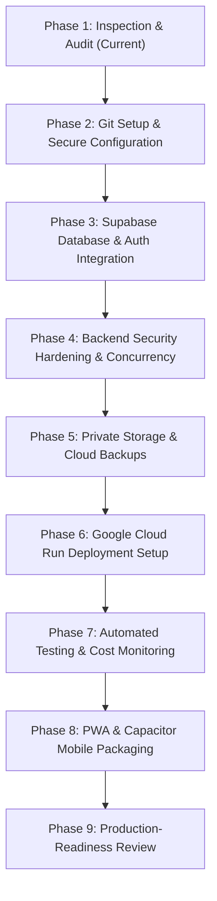

# 🏥 DOCURGENT 24/7 — COMPREHENSIVE INFRASTRUCTURE, SECURITY & ARCHITECTURE AUDIT

> **Author**: Lead Full-Stack Architect & Senior DevOps/Security Engineer  
> **Date**: November 11, 2026  
> **Target Pilot**: India (<100 Users, Web + Android + iOS via PWA/Capacitor)  
> **Deployment Target**: Google Cloud Run (`asia-south1` Mumbai) + Supabase (`ap-south-1` Mumbai)  
> **Compliance Context**: Indian Telemedicine Practice Guidelines (2020), Digital Personal Data Protection Act (DPDP 2023), HIPAA Security Principles

---

## EXECUTIVE SUMMARY

DocUrgent is an emergency-first doctor-patient teleconsultation platform built with a Python backend and a vanilla HTML5/CSS3/JavaScript frontend. It enables patients facing acute home accidents (chemical eye burns, stair falls, fractures, burns, deep bleeding) to undergo clinician-guided triage, match with board-verified doctors, conduct real-time WebRTC audio/video consultations, receive cryptographically signed prescriptions, and execute transactions under an 85/15 doctor payout model.

This audit evaluates the codebase across 10 critical dimensions to prepare for a secure, low-budget, highly reliable pilot in India without redesigning or complicating the user interface.

---

## 1. DETAILED SYSTEM INSPECTION & CURRENT ARCHITECTURE

```
                                  DocUrgent 24/7 Architecture
                              ┌──────────────────────────────────┐
                              │      "WHO ARE YOU?" GATE         │
                              └─────────────────┬────────────────┘
                     ┌──────────────────────────┼──────────────────────────┐
                     ▼                          ▼                          ▼
           ┌──────────────────┐       ┌──────────────────┐       ┌──────────────────┐
           │  PATIENT PORTAL  │       │  DOCTOR PORTAL   │       │   SUPER ADMIN    │
           │ • Emergency Gate │       │ • Credential Pad │       │ • Ownership MFA  │
           │ • Safety Check   │       │ • Pending Status │       │ • Doctor Verify  │
           │ • Doctor Match   │       │ • Live Call Queue│       │ • Audited PHI    │
           │ • WebRTC Video   │       │ • Signed Rx Pad  │       │ • 85/15 Finances │
           │ • Signed Rx Slip │       │ • Net 85% Payout │       │ • Online Backups │
           └──────────────────┘       └──────────────────┘       │ • Storage Health │
                                                                 │ • Maintenance Sw │
                                                                 └──────────────────┘
                                                │
                                 ┌──────────────┴──────────────┐
                                 ▼                             ▼
                       ┌──────────────────┐          ┌───────────────────┐
                       │   SQLite3 WAL    │          │  WebRTC Signaling │
                       │ docurgent.db     │          │  & Signed Storage │
                       └──────────────────┘          └───────────────────┘
```

### 1.1 Frontend Architecture
- **Tech Stack**: Vanilla ECMAScript 2020+ (`app.js`, 2,235 lines), semantic HTML5 (`index.html`, 1,616 lines), custom responsive CSS (`styles.css`, 3,154 lines).
- **SPA Screen Routing**: Uses a clean CSS-driven visibility pattern (`display: none` / `display: block`) between:
  1. Gate Screen ("Who are you?")
  2. Doctor Registration Credential Sheet
  3. Patient Directory & Triage Workspace
  4. Doctor Consultation Queue & Clinical Dashboard
  5. Admin / Super Admin Oversight Portal
  6. WebRTC Video Consultation Room
- **State Management**: Centralized reactive in-memory `state` object coupled with `sessionStorage` for token and role persistence.
- **PWA & Mobile Packaging Status**:
  - ❌ **Missing Manifest**: No `manifest.json` or Apple Web App meta tags are registered in `index.html`.
  - ❌ **Missing Service Worker**: No caching or offline capability registered.
  - ❌ **Capacitor Integration**: Not yet packaged into Android/iOS container wrappers.
- **Interface & UX Evaluation**: The interface is exceptionally clean, fast, and light-themed. It strictly respects clinical urgency and must not be redesigned.

### 1.2 Backend Framework & Server Entry Point
- **Tech Stack**: Pure Python 3.8+ standard library (`http.server.SimpleHTTPRequestHandler`, `server.py`, 1,992 lines). Zero pip dependencies for core execution.
- **Concurrency & Threading**:
  - **Risk**: The current entry point uses `socketserver.TCPServer`, which processes HTTP requests **synchronously** (one request at a time).
  - **Impact**: In a multi-user environment or during file downloads and WebRTC signal polling, incoming requests block waiting for the previous request to finish.
  - **Remediation**: Transition to `socketserver.ThreadingTCPServer` or an ASGI/WSGI production runner (Uvicorn / Gunicorn with multi-workers) for Cloud Run.
- **Routing & Payloads**: Custom REST dispatcher parsing `urllib.parse` queries and JSON bodies with centralized error handling and CORS headers.

### 1.3 Database & Data Storage
- **Current Engine**: Persistent SQLite3 (`docurgent.db`, ~260 KB) with Write-Ahead Logging (`WAL` mode), `PRAGMA foreign_keys = ON`, and a 5,000ms busy timeout.
- **Schema**: 15 relational tables:
  1. `users` (PBKDF2 passwords, roles, MFA TOTP secrets, recovery codes, lockout timers)
  2. `sessions` (token, role, 7-day expiration)
  3. `doctors` (license registration, hospital, degrees, fee, verification status)
  4. `patients` (emergency contact, age, allergies, medical history, telehealth consent)
  5. `consultations` (category, condition, status, fee, duration, doctor/patient linkage)
  6. `messages` (consultation-scoped real-time chat)
  7. `prescriptions` (clinical diagnosis, medications, HMAC-SHA256 signature hash)
  8. `payments` (transaction ref, gross, doctor payout, platform cut, status)
  9. `doctor_verifications` (audited administrative approval/rejection history)
  10. `audit_logs` (regulatory compliance event log)
  11. `webrtc_signals` (peer-to-peer SDP and ICE candidate queue)
  12. `system_settings` (dynamic commission %, maintenance mode, currency)
  13. `complaints` (patient/doctor feedback and dispute tracking)
  14. `error_logs` (runtime error monitoring telemetry)
  15. `doctor_payouts` (clinician settlement ledger)
- **Production Assessment**:
  - SQLite WAL is excellent for local single-instance desktop use.
  - **Cloud Run Conflict**: Cloud Run container instances are stateless and ephemeral. If Cloud Run scales to 2+ instances, a local SQLite file cannot be shared across instances, resulting in split-brain data loss.
  - **Recommended Migration**: Supabase PostgreSQL located in `ap-south-1` (Mumbai) with Row-Level Security (RLS). A turn-key schema [`docurgent/schema_supabase.sql`](file:///Users/cherishgoyal/Downloads/new2/docurgent/schema_supabase.sql) has already been authored.

### 1.4 Authentication, Roles & RBAC
- **Roles**: Strict 4-tier model: `patient`, `doctor`, `admin`, `super_admin`.
- **Password Security**: PBKDF2-SHA256 with 100,000 iterations and unique 16-byte random salt per user.
- **MFA Security**: Pure Python RFC 6238 TOTP implementation + 8 single-use emergency recovery codes.
- **Brute-Force Protection**: 15-minute account lockout triggered after 5 consecutive failed login attempts; token-bucket IP rate limiter (25 auth/min, 240 general/min).
- **Vulnerabilities Identified**:
  - ⚠️ **Doctor Auto-Login**: In `app.js` (line 215), `loginDoctorDefault()` hardcodes `identifier: 'rajesh.mehta@docurgent.org'` and `password: 'DoctorPass123!'`. When an unauthenticated user enters the doctor portal, they are automatically logged in as Dr. Rajesh Mehta!
  - ⚠️ **Patient Auto-Registration / Missing Login**: In `app.js` (line 875), if a returning patient enters their phone number during intake, `/api/auth/register-patient` returns a `409 Conflict`, leaving the session unauthenticated. A clean login / OTP lookup flow is needed.
  - ⚠️ **Wildcard CORS**: `server.py` sends `Access-Control-Allow-Origin: *`. In production, this must be restricted to the verified domain (`https://docurgent.in`) and mobile origins (`capacitor://localhost`, `http://localhost`).

### 1.5 File Storage Implementation
- **Current Mechanism**: Base64 JSON payload over `/api/upload`.
- **Validation**: 5MB size limit, extension whitelist (`.jpg`, `.jpeg`, `.png`, `.pdf`), magic byte inspection, SHA-256 content deduplication.
- **Access Control**: Saved to local `docurgent/uploads/` directory; accessed via short-lived HMAC-SHA256 signed tokens (`/api/files/download?file=...&token=...&expires=...`, 15-minute expiry).
- **Storage Limits Required**:
  - Profile Image: 2 MB
  - Patient Injury Image: 5 MB
  - Doctor Certificate: 10 MB
  - Prescription PDF: 10 MB
- **Production Vulnerability**: Storing files on local disk in Google Cloud Run will result in file loss upon container restart. Must migrate to Supabase Storage private buckets in Mumbai (`ap-south-1`).

### 1.6 Real-Time Video & Messaging
- **WebRTC Signaling**: In-database polling (`webrtc_signals` table) via `/api/webrtc/signal/send` and `/api/webrtc/signal/poll`.
- **STUN / TURN Status**:
  - Uses Google public STUN (`stun:stun.l.google.com:19302`).
  - ⚠️ **TURN Server Missing**: Direct peer-to-peer connections will fail on Indian cellular networks (Jio, Airtel 4G/5G) due to Symmetric NAT. A TURN relay server (e.g., Twilio Network Traversal or self-hosted Coturn) is mandatory for reliable mobile video calls.
- **Simulated vs Real**:
  - The WebRTC video streaming and chat implementations are **real, genuine code** using browser `RTCPeerConnection`, `getUserMedia`, and signaling.
  - The Doctor Workspace contains a practice button (`simulateIncomingCall`) intended for demonstration. This must remain explicitly partitioned and labeled as practice-only.

### 1.7 Payment Implementation
- **Current Mode**: Sandbox payment confirmation (`/api/payments/confirm`) with unique transaction refs, 85/15 revenue split calculation, duplicate payment rejection, refund processing, and invoice generation.
- **Production Gap**: Requires server-side integration with Razorpay (India's standard gateway for UPI, NetBanking, and RuPay cards) with HMAC-SHA256 webhook verification.

---

## 2. SECURITY & COMPLIANCE RISK MATRIX

| Risk Item | Severity | Current Status | Remediation Required |
| :--- | :---: | :--- | :--- |
| **Doctor Auto-Login (`app.js`)** | 🔴 Critical | Hardcoded `rajesh.mehta` credentials in JS | Remove `loginDoctorDefault()`; require credentials/OTP modal |
| **Cloud Run Ephemeral Storage** | 🔴 Critical | DB and uploads stored on container disk | Connect to Supabase PostgreSQL & Supabase Storage (`ap-south-1`) |
| **Symmetric NAT Video Failure** | 🟠 High | Only Google STUN configured | Configure authenticated TURN server for Indian cellular carriers |
| **Synchronous `TCPServer`** | 🟠 High | Single-threaded request handling | Switch to `ThreadingTCPServer` or ASGI/Uvicorn |
| **CORS Wildcard (`*`)** | 🟡 Medium | Open to any origin | Restrict to `https://docurgent.in` & Capacitor origins |
| **Security Headers Missing** | 🟡 Medium | No CSP, HSTS, X-Frame-Options | Inject security headers in all HTTP responses |
| **PWA & Mobile Wrapper** | 🟡 Medium | No `manifest.json` or Service Worker | Generate PWA assets & configure Capacitor wrapper |

---

## 3. PROPOSED PRODUCTION ARCHITECTURE FOR INDIA PILOT (<100 USERS)

```
                            Client Devices (India Pilot)
                 ┌──────────────────────────────────────────────┐
                 │  Web Browser / Android App / iOS App (PWA)   │
                 └──────────────────────┬───────────────────────┘
                                        │ HTTPS / WSS
                                        ▼
                             Google Cloud Run (Mumbai)
                      ┌────────────────────────────────────┐
                      │    DocUrgent Python Backend API    │
                      │   • Region: asia-south1            │
                      │   • 1 vCPU, 512 MiB Memory         │
                      │   • Min instances: 1 (emergency)   │
                      │   • Max instances: 3 (cost cap)    │
                      │   • Request timeout: 60s           │
                      └──────────────┬──────────────┬──────┘
                                     │              │
                   Postgres Connection Pooling      │ Private S3 API
                                     ▼              ▼
                     Supabase Managed Cloud (Mumbai: ap-south-1)
         ┌─────────────────────────────────────────────────────────────────┐
         │ • Supabase PostgreSQL (ACID data with Row-Level Security RLS)   │
         │ • Supabase Auth (Phone OTP & Secure Token Validation)           │
         │ • Supabase Storage (Private Encrypted Buckets: 2MB/5MB/10MB)    │
         └─────────────────────────────────────────────────────────────────┘
```

---

## 4. PHASED IMPLEMENTATION PLAN

Following the user's permanent development rules, changes will be executed in sequential, reversible phases:



### Phase 2: Git Setup & Secure Configuration
- Verify `.gitignore` and `.env.example`.
- Remove all fallback/hardcoded credentials from frontend and documentation.
- Maintain `develop` branch for staging and `main` for release tags.

### Phase 3: Database & Authentication
- Connect Python backend to Supabase PostgreSQL in `ap-south-1` (Mumbai).
- Apply Row-Level Security (RLS) policies for `patients`, `doctors`, and `admins`.
- Implement phone/email OTP authentication for patient intake and doctor logins.

### Phase 4: Backend Security & Admin Controls
- Upgrade `server.py` to `socketserver.ThreadingTCPServer` for non-blocking concurrency.
- Add standard security headers (`HSTS`, `Content-Security-Policy`, `X-Content-Type-Options`, `X-Frame-Options: DENY`, `Referrer-Policy`).
- Restrict CORS headers to authorized domains.
- Enforce doctor login modal; remove `loginDoctorDefault()`.

### Phase 5: File Storage & Backups
- Configure Supabase Storage private buckets (`doctor-certs`, `patient-uploads`, `prescriptions`).
- Enforce size limits: 2MB Profile, 5MB Patient Image, 10MB Doctor Cert, 10MB PDF.
- Implement server-side ClamAV/magic byte malware inspection.
- Ensure short-lived signed URLs for all document views.

### Phase 6: Cloud Run Deployment & Domain Setup
- Finalize production `Dockerfile` with non-root security.
- Document deployment to `asia-south1` (1 vCPU, 512 MiB, concurrency 20, timeout 60s).
- Configure custom domain mapping for `docurgent.in`.

### Phase 7: Automated Testing & Monitoring
- Expand test suite to verify Supabase connections, RLS policies, and mobile endpoints.
- Configure health check `/health` reporting database connectivity and storage alerts.
- Set up budget alert thresholds (70%, 85%, 95%) in Google Cloud Billing.

### Phase 8: PWA & Mobile Packaging (Capacitor)
- Create `manifest.json`, high-resolution icons (192px, 512px), and `sw.js` service worker.
- Prepare Capacitor configuration (`capacitor.config.json`) for Android and iOS builds.
- Verify camera, microphone, and file upload permissions in native WebView contexts.

### Phase 9: Production-Readiness Review
- Audit medical safety, emergency 112 routing, and consent records against Indian Telemedicine Guidelines 2020.
- Execute final end-to-end 32-point automated verification suite.
- Deliver all 9 required operational runbooks.
