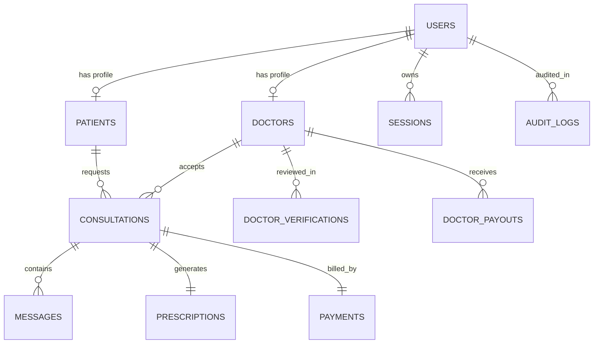

# DocUrgent — Database Architecture & Entity-Relationship Model

DocUrgent utilizes an ACID-compliant, thread-safe relational database architecture implemented in SQLite3 with Write-Ahead Logging (WAL) and foreign key enforcement, with turn-key compatibility for Supabase / PostgreSQL.

---

## 1. Entity-Relationship Model

---

## 2. Table Schemas & Relational Constraints

### `users`
Core identity table storing credentials and MFA keys:
- `id` (TEXT PRIMARY KEY): Unique identifier.
- `email` (TEXT UNIQUE): User email address.
- `phone` (TEXT): Primary contact telephone.
- `password_hash` (TEXT NOT NULL): PBKDF2-SHA256 hash.
- `salt` (TEXT NOT NULL): 16-byte cryptographic salt (hex).
- `role` (TEXT CHECK in ('patient', 'doctor', 'admin', 'super_admin')): Access scope.
- `is_active` (INTEGER DEFAULT 1): Account status (1 = Active, 0 = Suspended).
- `is_email_verified` (INTEGER DEFAULT 0): Verified status flag.
- `mfa_secret` (TEXT): Base32 RFC 6238 TOTP secret.
- `mfa_enabled` (INTEGER DEFAULT 0): TOTP enforcement flag.
- `recovery_code_hash` (TEXT): JSON array of single-use emergency recovery code hashes.
- `failed_login_attempts` (INTEGER DEFAULT 0): Brute-force counter.
- `locked_until` (TEXT): ISO timestamp until which login attempts are rejected.
- `created_at` (TEXT NOT NULL): Timestamp.

### `doctors`
Comprehensive clinician credential and availability record:
- `id` (TEXT PRIMARY KEY)
- `user_id` (TEXT UNIQUE REFERENCES users(id))
- `name` (TEXT NOT NULL)
- `specialty` (TEXT NOT NULL)
- `category` (TEXT NOT NULL): Triage grouping (`eye`, `stairs`, `burns`, `emergency`, `pediatric`, `general`).
- `degrees` (TEXT NOT NULL): Medical degrees (e.g., MBBS, MS, MD).
- `license_number` (TEXT NOT NULL): State/National Medical Council registration number.
- `hospital` (TEXT NOT NULL): Current working hospital affiliation.
- `experience_years` (INTEGER NOT NULL)
- `consultation_fee` (REAL NOT NULL)
- `verification_status` (TEXT CHECK in ('pending_verification', 'under_review', 'verified', 'rejected', 'suspended'))
- `is_available` (INTEGER DEFAULT 1): Real-time availability toggle.
- `avatar` (TEXT), `certificate_url` (TEXT)

### `consultations`
The emergency encounter lifecycle:
- `id` (TEXT PRIMARY KEY)
- `patient_id` (TEXT REFERENCES patients(id))
- `doctor_id` (TEXT REFERENCES doctors(id))
- `category` (TEXT NOT NULL)
- `condition_desc` (TEXT NOT NULL)
- `status` (TEXT CHECK in ('safety_checked', 'requested', 'accepted', 'in_progress', 'completed', 'cancelled', 'rejected'))
- `fee` (REAL NOT NULL)
- `call_duration_seconds` (INTEGER DEFAULT 0)
- `started_at` (TEXT), `completed_at` (TEXT), `cancellation_reason` (TEXT)

### `prescriptions`
Authenticated clinical assessment and digital signature:
- `id` (TEXT PRIMARY KEY)
- `consultation_id` (TEXT UNIQUE REFERENCES consultations(id))
- `doctor_id` (TEXT REFERENCES doctors(id))
- `clinical_assessment` (TEXT NOT NULL)
- `diagnosis` (TEXT NOT NULL)
- `first_aid_instructions` (TEXT)
- `medications_json` (TEXT)
- `digital_signature_hash` (TEXT): SHA-256 HMAC of doctor license, consultation ID, timestamp, and diagnosis.
- `is_signed` (INTEGER DEFAULT 1)

### `system_settings`
Persistent operational parameters:
- `key` (TEXT PRIMARY KEY)
- `value` (TEXT NOT NULL)
- `updated_at` (TEXT NOT NULL)
- `updated_by` (TEXT)
